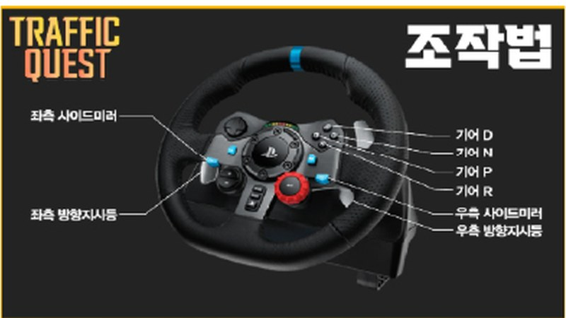
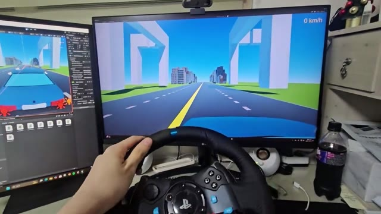
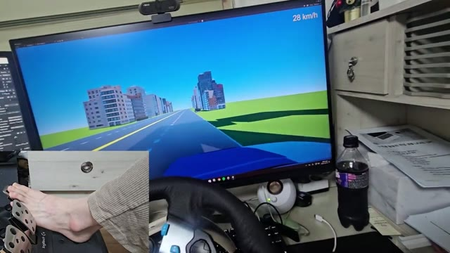
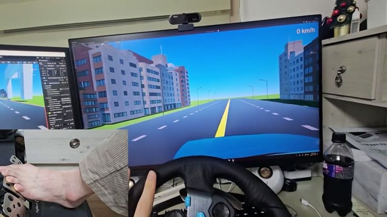

<p align="center"></p>

# Traffic Quest

> Logitech G29 휠·페달로 수원의 실제 도로를 달리며 교통법규를 익히는 Unity 운전 시뮬레이터
> 아주대학교 파란학기(2024-2) · 팀 교아정 3인 · 2024.09 – 2024.12

## ▶ 플레이 영상

https://github.com/user-attachments/assets/894a5ae9-7460-48e3-8bdc-31b1a652de7c

<p align="center">2024년 10월 중간교류회 시연 · G29 휠·페달 주행 · 54초. 신호 위반·과속·충돌 판정은 이후 최종본에서 추가되어 이 영상에는 없습니다.</p>

## 한 줄 소개

초보 운전자나 장롱면허 운전자가 헷갈리기 쉬운 교통법규를, 실제 휠과 페달로 운전하며 몸으로 익히게 만든 시뮬레이터입니다. 스테이지는 아주대 정문, 팔달문, 세류초등학교 주변 등 수원의 실제 장소를 바탕으로 했습니다.

| 주행 | 시내 구간 | 건물 사이 도로 |
|---|---|---|
|  |  |  |

## 게임 흐름

```
메인 메뉴 → 스테이지 선택 → 로딩 → 주행
                                   │ G29 휠·페달·기어·방향지시등 버튼
                                   ├ 신호등 구역에서 빨간불에 멈춰 있지 않으면 → 신호 위반 게임오버
                                   ├ 제한 속도 구역에서 속도를 넘기면 → 과속 게임오버
                                   ├ 건물에 부딪히면 → 충돌 게임오버
                                   ├ 교차로마다 좌·우·직진 길 안내
                                   └ 도착 지점에서 정차하면 → 스테이지 선택으로
```

## 주요 기능

| 영역 | 내용 |
|---|---|
| 입력 | Logitech Gaming SDK로 G29 휠·가속·브레이크·버튼을 읽고, 핸들 저항(댐퍼)을 걸어 실제 핸들 감각에 가깝게 함 |
| 차량 | WheelCollider 4개 기반 주행, 가속·브레이크, 안티롤, 기어, 방향지시등 |
| 교통법규 판정 | 신호 위반(빨간불 구역에 8초 머묾), 과속(제한 속도 + 9 초과가 8초 지속), 건물 충돌 → 각각 다른 게임오버 화면 |
| 안내 | 속도계, 제한 속도 표지, 트리거 기반 좌·우·직진 길 안내 이미지, 사이드미러 |
| 사운드 | 가속 페달 깊이에 따라 주행음·대기음 볼륨이 부드럽게 바뀜, 방향지시등 깜빡이 소리 |
| UI | 메인 메뉴, 스테이지 선택, 로딩 바, 게임오버·재시작 |

## 팀과 역할

| 파트 | 담당 |
|---|---|
| 팀장 · 차량 주행 초기 구현 · 방향지시등 | 이재찬 |
| 3D 모델링 · 리깅 | 김동욱 |
| **G29 입력·차량 제어(공동), 교통법규 판정, UI·씬 흐름, 차량 사운드, 스테이지 기획 조사** | **송재혁** |

### 내가 맡은 일 (송재혁)

- **교통법규 판정:** 신호등 구역·제한 속도 구역·도착 지점을 트리거로 나누고, 신호 상태와 속도를 확인해 신호 위반·과속·충돌 게임오버로 연결했습니다.
- **차량 주행 (팀원과 공동):** G29 입력을 WheelCollider 차량 제어에 연결하고, 브레이크를 밟는 중에도 저속 자동 가속이 걸리던 문제를 고쳤습니다.
- **UI·씬 흐름:** 메인 메뉴 → 스테이지 선택 → 로딩 → 주행으로 이어지는 화면과 로딩 바를 만들었습니다.
- **차량 사운드:** 페달 입력에 맞춰 주행음과 공회전음을 섞고, 방향지시등 소리를 G29 버튼과 연결했습니다.
- **스테이지 기획 조사:** 교차로 우회전(도로교통법 시행규칙 별표 2), 회전교차로 통행, 유턴 허용 조건을 정리했습니다.

`src/`에는 시연 직전 최종본(2024-11-21)의 스크립트를 담았습니다. `Player.cs`의 주행 부분은 팀원과 함께 작성했고, 판정 부분(645행부터)과 `GameOver.cs`, `TrafficLightController.cs`, `JaeHyuk/Scripts/`, `Sound/`는 제가 작성했습니다.

## 기술 스택

Unity 2022.3 · C# · Logitech Gaming SDK (G29) · WheelCollider · 트리거 기반 규칙 판정

## 이 저장소에 대해

소개용 저장소입니다. 전체 프로젝트에는 Asset Store 지형·도로·차량 에셋과 100MB가 넘는 씬 파일이 있어 공개하지 않고, 게임 소개와 플레이 영상, 최종본 스크립트만 담았습니다.
